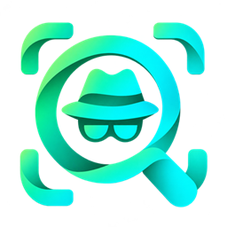

# 🥑 OSINT Hub — GuacamoleGH

  

  <strong>Directorio curado, estructurado y autohospedado de inteligencia de fuentes abiertas (OSINT).</strong> 
  Especializado en fuentes públicas oficiales de España y la Unión Europea, herramientas de doble uso y ciberseguridad defensiva.

  
  
  
  
  

---

## 💡 ¿Qué es OSINT Hub?

**OSINT Hub** es una plataforma web integral diseñada para analistas de inteligencia, auditores de ciberseguridad, periodistas de investigación y peritos judiciales. Centraliza centenares de herramientas especializadas, registros oficiales de administraciones públicas, plataformas de práctica (CTFs) y metodologías técnicas en una interfaz ágil, moderna y sin dependencias de bases de datos.

A diferencia de marcadores estáticos o listados caóticos, cada recurso está modelado con un esquema de datos formal validado mediante **Zod**, con fecha de última verificación (`lastReviewed`), control de tipología (`pricing`, `geographicScope`, `difficulty`), monitoreo automatizado de disponibilidad y categorización multidimensional.

---

## 🎯 Principios de Diseño y Privacidad

1. **Arquitectura 100% Pasiva y Segura:**  
   OSINT Hub no realiza peticiones salientes contra objetivos ni almacena registros de actividad o historiales de búsqueda en servidores remotos. Toda la navegación, filtrado y búsqueda difusa se resuelve en el cliente o mediante páginas pre-renderizadas estáticamente (**SSG**).
2. **Prioridad en Fuentes Oficiales (España y UE):**  
   Fuerte foco en registros públicos fiables (BOE, BORME, Catastro, DGT, CENDOJ, Registradores, Registro Concursal, CNMV, EUIPO, TED Europa, VIES, etc.) frente a herramientas opacas de scraping.
3. **Control Continuo de Calidad:**  
   Un workflow automatizado de GitHub Actions comprueba periódicamente el estado HTTP y la resolución de todos los enlaces para evitar el decaimiento de hipervínculos (*link rot*).

---

## 🧭 Estructura del Catálogo

El conocimiento se organiza bajo un modelo de navegación dual que permite abordar una investigación desde dos perspectivas:

### 1. Por Disciplina Técnica (12 Categorías)

| Disciplina | Ámbito de Aplicación |
| :--- | :--- |
| **Public Records** | Boletines oficiales (BOE, BORME, BOJA, BOP), registros mercantiles, jurídicos (CENDOJ, TEJU), marcas, patentes y transparencia institucional. |
| **GEOINT** | Cartografía oficial (IGN, Iberpix, PNOA histórico desde 1929), catastro, parcelas agrícolas (SIGPAC), redes de infraestructuras y mapas abiertos. |
| **Satellite** | Teledetección y observación terrestre con misiones de la ESA (Copernicus Sentinel), NASA, USGS y mosaicos de alta resolución. |
| **IMINT** | Análisis forense de imágenes y vídeos, procedencia criptográfica (C2PA / Content Credentials), metadatos EXIF/GPS y detección de contenido generado por IA. |
| **Chronolocation** | Cronolocalización de fotografías y vídeos mediante análisis de sombras solares (SunCalc), partes meteorológicos históricos (METAR/SYNOP) y efemérides astronómicas. |
| **SOCMINT** | Verificación de desinformación (fact-checking contrastado por IFCN), rastreo de alias en foros y comunidades públicas. |
| **WEBINT** | Preservación digital y archivos web históricos (Wayback Machine, Perma.cc), análisis de infraestructura de dominios, tecnologías (BuiltWith) y grafos de conocimiento. |
| **Cyber Intelligence** | Plataformas de ciberinteligencia (IoCs, C2, malware), telemetría de red BGP/ASN, motores de búsqueda de superficie de ataque (ZoomEye, LeakIX) y avisos de CERTs. |
| **SIGINT** | Inteligencia de señales: redes Wi-Fi globales (WiGLE), receptores comunitarios de radio definida por software (SDR / KiwiSDR) y emisiones de emergencias. |
| **Transport** | Rastreo y telemetría de aviación civil (ADS-B, flotas, matrículas), tráfico marítimo (AIS), cámaras viales de la DGT y operaciones aeroportuarias. |
| **Search** | Motores de búsqueda especializados, dorking avanzado y metabuscadores. |
| **General** | Navajas suizas de desofuscación (CyberChef), minería relacional (Maltego, Gephi), literatura académica en acceso abierto (Dialnet, OpenAlex) y métricas estadísticas (INE, Eurostat). |

### 2. Por Selector Objetivo ("Investigate By")

¿Qué dato tienes al comenzar la investigación? El catálogo permite filtrar herramientas según el punto de partida:

- 👤 **Usuario / Alias (`username`):** Huella digital de nombres de usuario en cientos de plataformas.
- ✉️ **Correo Electrónico (`email`):** Verificación de cabeceras, entregabilidad y presencia pública.
- 📞 **Teléfono (`phone`):** Prefijos, operadores y rastreo de contactos en clasificados.
- 🚗 **Vehículo (`vehicle`):** Informes reducidos oficiales de la DGT, matrículas aeronáuticas e historiales de flotas.
- 🏢 **Empresas (`companies`):** Registro Mercantil, administradores, cuentas anuales y licitaciones públicas.
- 💼 **Empleo (`jobs-careers`):** Portales profesionales, estructuras de contratación y ofertas laborales.
- 🌐 **Dominio / IP (`domain-ip`):** DNS pasivo, ASN, certificados SSL y hosting.
- 📍 **Ubicación Geográfica (`location`):** Coordenadas, ortofotos, cámaras viales e imágenes a pie de calle.
- 🛡️ **Fraude y Estafas (`fraud-scams`):** Alertas de chiringuitos de la CNMV, listas negras de phishing, denuncias de wallets de criptomonedas y productos peligrosos.
- 🏷️ **Clasificados (`classifieds`):** Análisis de perfiles de venta en segunda mano, vehículos e inmobiliaria (Wallapop, Milanuncios, Idealista).
- 👥 **Personas y Profesionales (`people-professional`):** Colegiados, autores académicos, cargos públicos y hemerotecas históricas.
- 💬 **Redes Sociales (`social-media`):** Canales y grupos de debate abiertos.
- 🎮 **Videojuegos (`gaming`):** SteamIDs y comunidades gaming públicas.
- 💻 **Desarrolladores (`github-dev`):** Commits, repositorios y autores de código.

---

## ⚡ Módulos y Funcionalidades Adicionales

### 🔍 Buscador Global Inteligente (`Ctrl + K` / `/`)
Búsqueda difusa reactiva con Fuse.js, con tolerancia a erratas, filtrado instantáneo por etiquetas y sinónimos bilingües cruzados (ej. *matrícula* ↔ *vehicle*, *correo* ↔ *email*, *sol* ↔ *suncalc*, *wifi* ↔ *bssid*).

### 🛠️ Generador de Dorks y Exposición (`/guides`)
Formulario interactivo para construir consultas adaptadas al dominio examinado con el fin de auditar configuraciones indexadas por error (archivos de configuración, volcados de bases de datos o directorios internos).

### 🏆 Centro de Práctica y Desafíos (`/challenges`)
Selección estructurada de plataformas de práctica, CTFs, ejercicios forenses y retos de geolocalización clasificados por nivel de dificultad.

### 📚 Guías y Metodologías (`/guides`)
Compendio de referencias metodológicas, flujos de investigación paso a paso y mejores prácticas operativas.

---

## ⚖️ Marco Legal y Uso Ético (RGPD y LOPDGDD)

> [!WARNING]
> **Herramientas de Doble Uso (Dual-Use)**: Este portal cataloga recursos legítimos de investigación (como Sherlock, Maigret, Blackbird, informes de vehículos de la DGT o rastreadores de mensajería pública). Aunque son esenciales en auditorías de seguridad defensiva, verificación periodística y peritajes judiciales, también pueden ser objeto de abuso.

- **Ámbito normativo (España y UE):** Toda recopilación o tratamiento de datos personales está regulada por el **Reglamento General de Protección de Datos (RGPD UE 2016/679)** y la **Ley Orgánica 3/2018 (LOPDGDD)**.
- **Autorización previa:** Utiliza las herramientas y consultas exclusivamente sobre **dominios e infraestructura propios, o bajo autorización expresa y legítima**.
- **Portal pasivo:** OSINT Hub no ejecuta solicitudes contra terceros ni recopila datos de los usuarios. Consulta más detalles en la sección [`/about`](src/app/about/page.tsx).

---

## 🚀 Instalación y Puesta en Marcha

Para instrucciones detalladas sobre cómo compilar en local o desplegar en contenedores Docker securizados, consulta:

👉 **[Guía de Compilación y Puesta en Marcha (BUILD.md)](BUILD.md)**

Para despliegues avanzados en entornos Homelab, túneles con Cloudflare y variables de entorno, consulta [docs/DEPLOY.md](docs/DEPLOY.md).

---

## 🤝 Contribuciones

¿Quieres proponer una nueva herramienta o registro oficial?
Consulta los criterios de inclusión y el esquema JSON esperado en la **[Guía de Contribución (CONTRIBUTING.md)](CONTRIBUTING.md)**.

---

## 📄 Licencia

Este proyecto está bajo la licencia [MIT](LICENSE). Desarrollado para el ecosistema **GuacamoleGH**.
